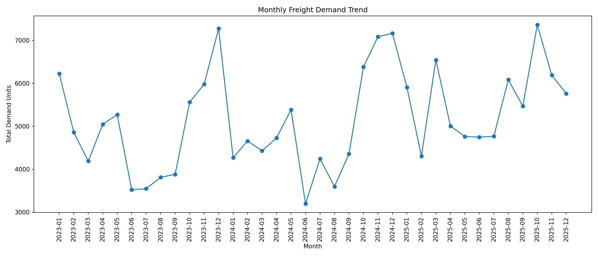
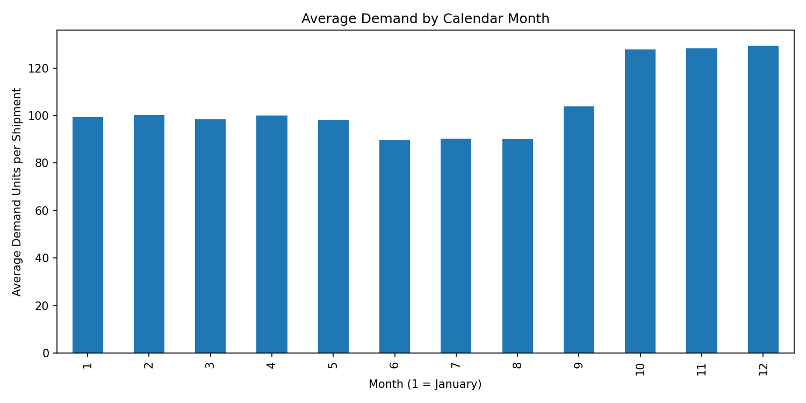
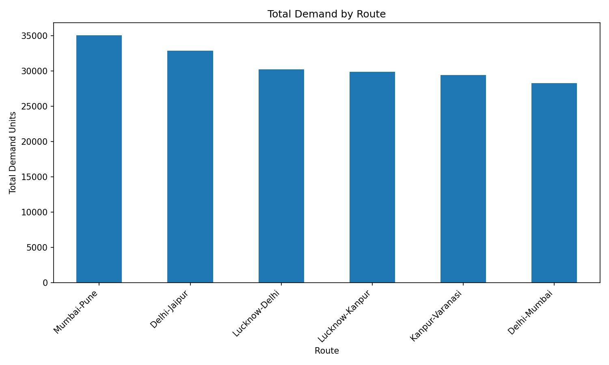
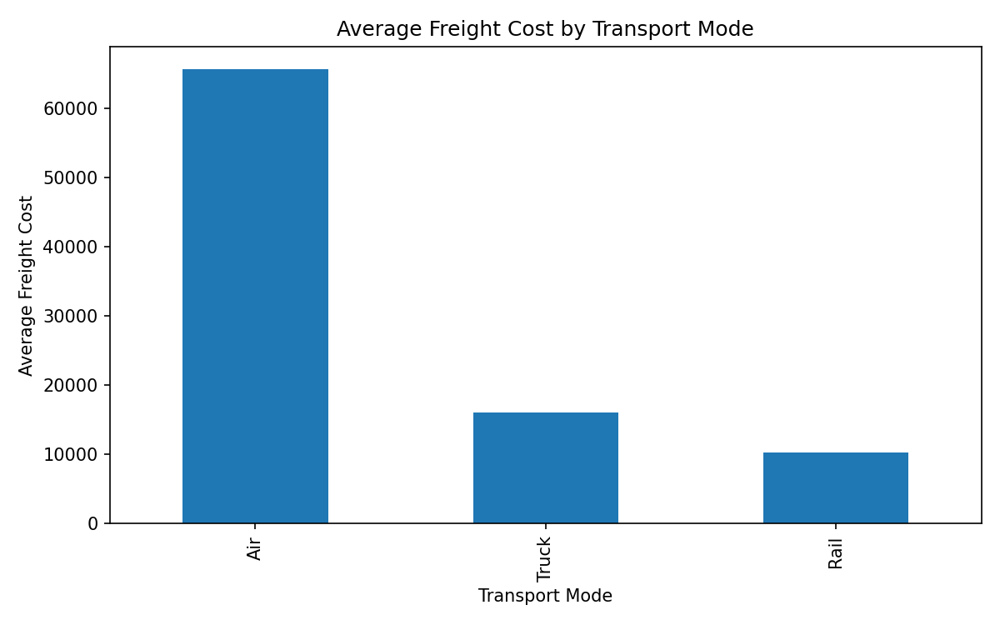
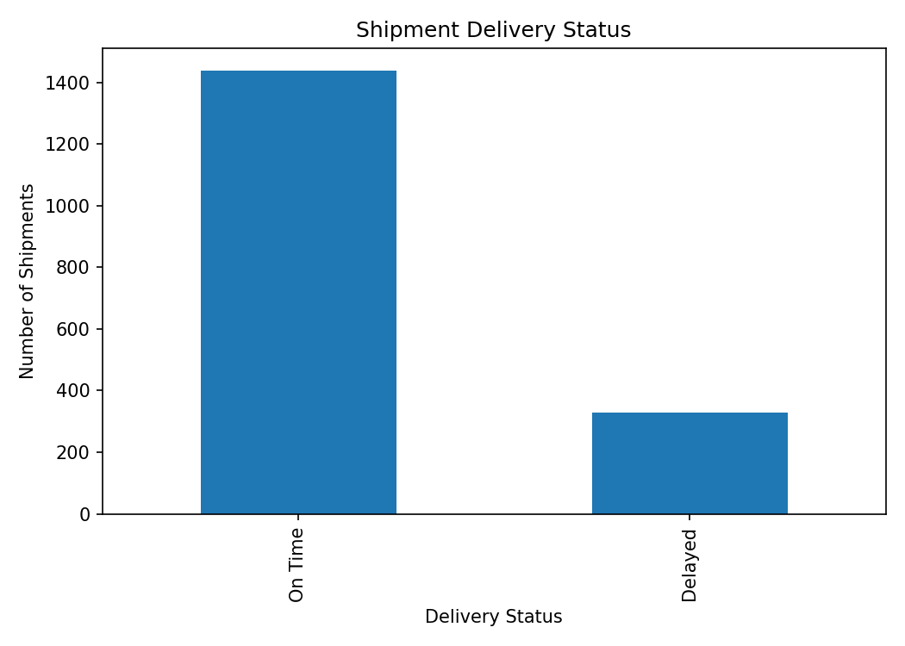
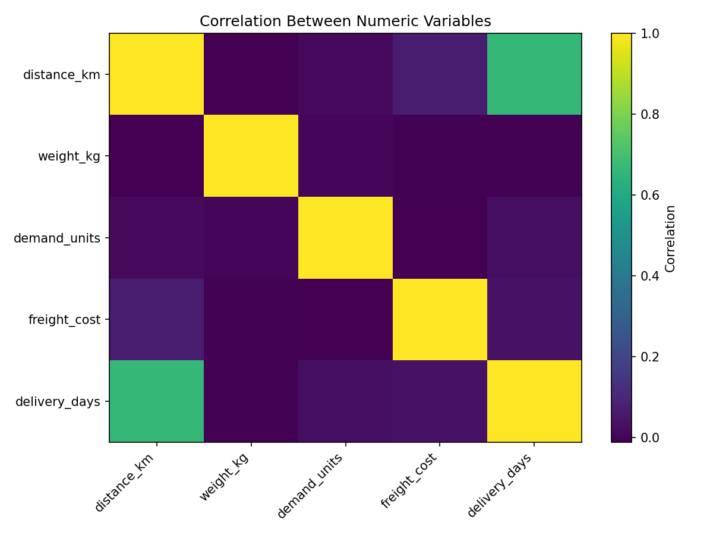

<div align="center">

# 🚚 Logistics Demand Forecasting

**An end-to-end data analytics project: from raw freight data to SQL insights and a monthly demand forecasting pipeline.**


</div>

---

## 📌 Overview

Logistics companies lose money when they plan capacity blindly: too few vehicles means delayed deliveries, too many means idle cost. This project simulates the full workflow of a logistics data analyst, taking messy shipment records and turning them into **clean data, business insights, and forecast-ready features** to predict monthly freight demand.

| | |
|---|---|
| **Domain** | Logistics & Supply Chain |
| **Period covered** | Jan 2023 – Dec 2025 (36 months) |
| **Raw records** | 1,810 shipments (including injected errors and duplicates) |
| **Clean records** | 1,768 shipments |
| **Routes** | 6 (Lucknow–Delhi, Delhi–Mumbai, Lucknow–Kanpur, Mumbai–Pune, Delhi–Jaipur, Kanpur–Varanasi) |
| **Transport modes** | Truck, Rail, Air |

> **Note:** The dataset is **synthetic**, generated with a fixed random seed (`42`) so the work is fully reproducible. Real-world patterns such as seasonality, mode-based pricing, and delivery delays were built in, along with deliberate data-quality problems to practise cleaning.

---

## 🎯 Objectives

1. Generate a realistic, messy freight dataset
2. Clean and validate the data with a documented, repeatable process
3. Explore demand, cost, and delivery patterns visually
4. Answer 15 business questions using SQL
5. Engineer time-series features (lags, rolling averages, seasonality)
6. Forecast monthly demand and evaluate model accuracy *(in progress)*

---

## 🗂️ Project Structure

```
DemandForecasting/
│
├── 01_dataset_creation/
│   └── creating_logistics_dataset.py     # Generates the raw synthetic dataset
│
├── 02_data_cleaning/
│   ├── 01_raw_freight_data.csv           # Raw data (with errors)
│   ├── 02_cleaning.py                    # Cleaning & validation pipeline
│   └── 03_cleaned_freight_data.csv       # Analysis-ready data
│
├── 03_EDA/
│   ├── 01_demand_analysis.py             # Exploratory analysis & charts
│   └── 02_outputs/                       # Saved visualizations (PNG)
│
├── 04_sql_analysis/
│   └── creating_tables.sql               # Database & table schema
│
├── 05_business_ques.sql                  # 15 business questions in SQL
│
├── 06_feature_engineering/
│   ├── 01_feature_engineering.py         # Monthly aggregation + time-series features
│   └── 02_freight_features.csv           # Forecast-ready feature table
│
├── 07_demand_forcasting/                 # Forecasting model (in progress)
│
└── README.md
```

---

## 🔄 Workflow

```
Dataset Creation → Data Cleaning → EDA → SQL Analysis → Feature Engineering → Forecasting
```

### 1️⃣ Dataset Creation
Generates 1,800 shipments with route, transport mode, cargo type, distance, weight, demand units, freight cost, delivery days, delivery status, and region. Realistic behaviour is built in:

- **Seasonality:** demand is ×1.30 in Oct–Dec (peak season) and ×0.90 in Jun–Aug
- **Mode-based pricing:** Truck ₹12/km, Rail ₹7/km, Air ₹35/km, plus a weight charge
- **Delays:** deliveries taking more than 5 days are marked *Delayed*

Data-quality problems are then **intentionally injected** to practise cleaning: missing values, invalid dates (e.g. `2025-15-40`), inconsistent text (`"truck "`, `"on time "`), invalid categories (`Helicopter`), negative or zero values, wrong data types (`"unknown"` in numeric columns), missing IDs, extreme freight-cost outliers, and 10 duplicate rows.

### 2️⃣ Data Cleaning
A step-by-step pipeline in `02_cleaning.py`:

| Step | What it does |
|---|---|
| Duplicates | Removes exact duplicate rows and duplicate shipment IDs |
| Text standardisation | Trims whitespace and fixes capitalisation |
| Dates | Converts to datetime and drops invalid or missing dates |
| Numeric conversion | Converts text such as `"unknown"` to proper numbers or NaN |
| Invalid values | Treats zero or negative distance, weight, demand, cost, and delivery days as missing |
| Category validation | Replaces unknown modes, cargo types, and routes with the most frequent valid value |
| Missing values | Median for numeric columns, mode for categorical columns |
| Outliers | Flagged using the IQR rule and **retained**, since they may be genuine |

**Result:** 1,810 → 1,768 rows, ready for analysis.

### 3️⃣ Exploratory Data Analysis
Six charts were produced from the cleaned data, with the key findings below.

### 4️⃣ SQL Analysis
A MySQL database (`logistics_analytics`) with a `freight_data` table. `05_business_ques.sql` answers **15 business questions**, covering:

- Top routes by demand and shipment count
- Transport modes with above-average freight cost
- Regions by demand and delivery time
- Monthly demand, freight spend, and delivery time trends
- Actual vs distance-based estimated freight cost
- **Window functions:** ranking, month-over-month comparison, and cumulative demand
- Most recent shipment per route

### 5️⃣ Feature Engineering
Shipment-level data is aggregated to **monthly** level (36 data points), then enriched with forecasting features:

| Feature type | Columns |
|---|---|
| Aggregates | `demand_units`, `total_shipments`, `total_freight_cost`, `avg_delivery_days`, `avg_distance_km` |
| Lag features | `lag_1`, `lag_2`, `lag_3`, `lag_12` (same month last year) |
| Rolling averages | `rolling_mean_3`, `rolling_mean_6` |
| Seasonality | `month_number`, `quarter`, `month_sin`, `month_cos` |

> Rolling averages use `shift(1)` first, so each row uses **only past demand**. This prevents data leakage, a common mistake in time-series projects.

### 6️⃣ Demand Forecasting *(in progress)*
Next steps: train a regression model (XGBoost) using a **time-based train/test split**, compare it against a naive baseline, and evaluate it with MAE, RMSE, and MAPE.

---

## 📊 Key Insights

| Metric | Finding |
|---|---|
| **Total demand** | 185,664 units across 3 years |
| **Top route by demand** | Mumbai–Pune (35,065 units), followed by Delhi–Jaipur (32,851) |
| **Peak season** | Oct–Dec average ~128 units per shipment vs ~100 in normal months (about **+28%**) |
| **Low season** | Jun–Aug average ~90 units per shipment (about **−10%**) |
| **Freight cost by mode** | Air ₹65,601 vs Truck ₹16,007 vs Rail ₹10,238 (average per shipment) |
| **Delivery performance** | 81.4% on time, 18.6% delayed |
| **Mode share** | Truck 67%, Rail 25%, Air 8% of shipments |
| **Yearly demand** | 2023: 59,203, 2024: 59,529, 2025: 66,932 units |

**What this means for the business:** demand is strongly seasonal, so capacity and driver planning should be scaled up before October. Air freight costs about 4× more than trucks per shipment, so shifting non-urgent cargo to Rail or Truck is a clear cost lever.

---

## 🖼️ Visualizations

<table>
<tr>
<td></td>
<td></td>
</tr>
<tr>
<td></td>
<td></td>
</tr>
<tr>
<td></td>
<td></td>
</tr>
</table>

---

## 🛠️ Tech Stack

| Area | Tools |
|---|---|
| Language | Python 3 |
| Data handling | Pandas, NumPy |
| Visualization | Matplotlib |
| Database | MySQL |
| Modelling (planned) | XGBoost, scikit-learn |

---

## ▶️ How to Run

```bash
# 1. Clone the repository
git clone https://github.com/nimish0001/DemandForecasting.git
cd DemandForecasting

# 2. Install dependencies
pip install pandas numpy matplotlib

# 3. Run each stage in order
python 01_dataset_creation/creating_logistics_dataset.py
python 02_data_cleaning/02_cleaning.py
python 03_EDA/01_demand_analysis.py
python 06_feature_engineering/01_feature_engineering.py
```

> The scripts read and write files in your **Downloads** folder. After running a stage, the output CSV is saved there. For the SQL part, run `04_sql_analysis/creating_tables.sql`, import the cleaned CSV into the `freight_data` table, then run `05_business_ques.sql`.

---

## 🧠 Skills Demonstrated

- Data generation and simulation with realistic business logic
- Data cleaning and validation on messy real-world-style data
- Exploratory data analysis and business storytelling
- SQL: aggregations, subqueries, and window functions
- Time-series feature engineering without data leakage
- Structured, reproducible project organisation

---

## 🚀 Roadmap

- [x] Dataset creation
- [x] Data cleaning
- [x] Exploratory data analysis
- [x] SQL business analysis (15 questions)
- [x] Feature engineering
- [ ] XGBoost demand forecasting model
- [ ] Model evaluation (MAE, RMSE, MAPE) vs baseline
- [ ] Forecast visualizations (actual vs predicted)
- [ ] Interactive dashboard (Power BI / Streamlit)

---

## 👤 Author

**Nimish Jaiswal** — Data Analyst

🔗 [GitHub](https://github.com/nimish0001) · [LinkedIn](https://www.linkedin.com/in/nimish-jaiswal0017/)

> ⭐ If you found this project useful, consider giving it a star!
